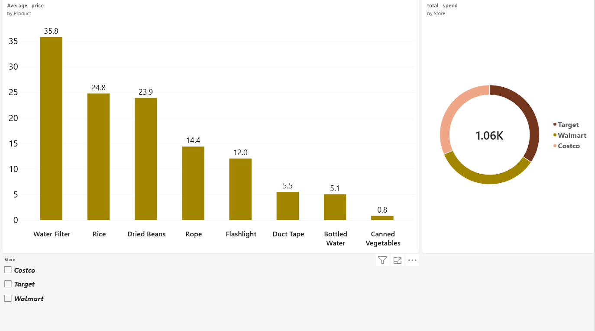

# 📊 Data Analytics & Visualization Portfolio

Welcome to my data analytics repository! This folder showcases end-to-end data projects including **SQL Data Cleaning**, **Excel Dynamic Dashboards**, and **Power BI Interactive Reports**.

---

## 🛍️ 1. Emergency Supplies Data Analysis (Power BI)
* **Tools Used:** Power BI Desktop, Power Query, DAX.
* **Overview:** Interactive analysis of emergency supplies distribution, tracking inventory metrics and demand trends.

### 🖼️ Dashboard Preview

---

## 📉 2. Global Layoffs & Funding Analysis (Excel)
* **Tools Used:** Microsoft Excel, Pivot Tables, Dynamic Pivot Charts.
* **Overview:** Comprehensive analysis of global tech layoffs, analyzing top companies, industry impact, and funding stage trends.

### 🖼️ Dashboard Preview

---

## 🧹 3. SQL Data Cleaning Pipelines
* **`layoffs_data_cleaning.sql`**: Complete data cleaning pipeline in MySQL (handling duplicates, standardizing text, null values, and removing unnecessary columns).
* **`sales_data_cleaning.sql`**: Sales order ETL and cleaning operations.
* **`HR_Attrition_Project.md`**: HR dataset analysis and aggregation documentation.
  
